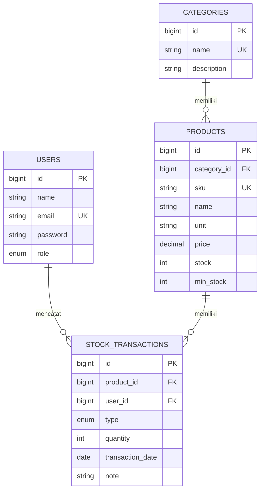
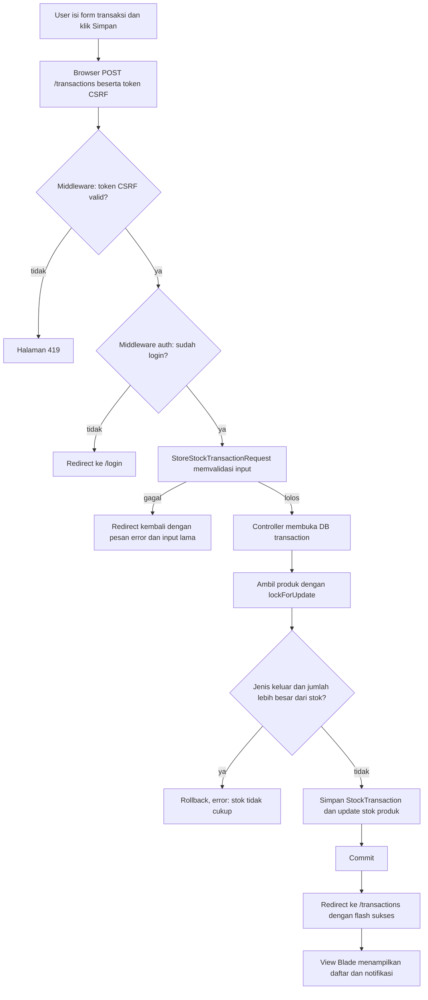

# PRD: Sistem Manajemen Inventaris Gudang

UAS Web Application Development, individual. Simpan sebagai `docs/PRD.md` di repository.

## 1. Ringkasan

Aplikasi web server-side (Laravel, pola MVC, MySQL) untuk mencatat barang, kategori, dan keluar-masuk stok di gudang. Admin mengelola data master. Staff mencatat transaksi stok. Dashboard menampilkan ringkasan dan daftar barang yang stoknya menipis.

**Masalah yang diselesaikan:** pencatatan stok manual sering tidak sinkron dan tidak ada jejak siapa mengubah stok.

**Tujuan:**
1. Stok barang selalu sama dengan hasil penjumlahan riwayat transaksinya.
2. Akses dibatasi per peran (admin dan staff).
3. Aplikasi bisa diakses online dan penulisnya bisa menjelaskan setiap baris kodenya.

## 2. Batasan dari soal (tidak boleh dilanggar)

- Laravel + MySQL, arsitektur MVC, Eloquent ORM atau Query Builder.
- CRUD penuh dengan validasi server-side.
- Registrasi, login, logout, dan manajemen session.
- Proteksi CSRF, pencegahan XSS, parameterized queries.
- Dilarang memakai starter kit atau generator kode (Breeze, Jetstream, Fortify, Filament, Voyager, dan sejenisnya). Autentikasi ditulis manual.
- Tampilan memakai Tailwind CSS yang di-build dengan Vite (bawaan Laravel). Seluruh markup dan logika ditulis sendiri.
- Commit Git dibuat bertahap, satu commit per fitur.
- Deploy ke hosting publik. Repo harus punya `README.md`, `.env.example`, dan file `.sql`.

## 3. Peran pengguna

| Peran | Siapa | Cara mendapat peran |
|---|---|---|
| admin | Pengelola gudang | Dibuat lewat seeder |
| staff | Petugas gudang | Otomatis saat registrasi |

Peran tidak pernah dibaca dari input form. Kolom `role` diisi oleh server.

## 4. Ruang lingkup

**Dikerjakan:** registrasi, login, logout, dashboard, CRUD kategori, CRUD produk (cari, filter, paginasi), transaksi stok masuk dan keluar, riwayat transaksi, halaman error kustom.

**Tidak dikerjakan:** REST API, upload gambar, reset password, verifikasi email, ekspor laporan, notifikasi, multi-gudang.

## 5. Fitur dan kriteria penerimaan

Prioritas: P0 wajib selesai, P1 dikerjakan jika waktu cukup, P2 dibuang jika waktu mepet.

| ID | Fitur | Prioritas | Kriteria penerimaan |
|---|---|---|---|
| F-01 | Registrasi | P0 | Form nama, email, password, konfirmasi. Email unik. Password disimpan ter-hash. Setelah sukses, user langsung login sebagai staff. |
| F-02 | Login dan logout | P0 | Kredensial salah menampilkan pesan umum tanpa membocorkan mana yang salah. Login dibatasi 5 percobaan per menit. Logout menghapus session dan membuat token CSRF baru. |
| F-03 | Kontrol akses per peran | P0 | Staff yang membuka URL khusus admin mendapat halaman 403. Tamu yang membuka halaman terproteksi diarahkan ke login. |
| F-04 | Dashboard | P0 | Menampilkan total produk, total kategori, jumlah produk stok menipis, jumlah transaksi hari ini, 5 produk stok terendah, dan 5 transaksi terbaru. |
| F-05 | CRUD kategori | P0 | Admin bisa tambah, ubah, hapus. Kategori yang masih punya produk tidak bisa dihapus dan muncul pesan error yang jelas. |
| F-06 | CRUD produk | P0 | Admin bisa tambah, ubah, hapus. Staff hanya melihat. Daftar bisa dicari (nama atau SKU), difilter kategori, dan dipaginasi 10 per halaman. Produk yang sudah punya transaksi tidak bisa dihapus. |
| F-07 | Transaksi stok | P0 | Admin dan staff bisa mencatat stok masuk atau keluar. Stok keluar melebihi stok tersedia ditolak dengan pesan error. Stok produk berubah otomatis. Transaksi mencatat siapa pelakunya. |
| F-08 | Filter riwayat transaksi | P1 | Filter jenis, produk, dan rentang tanggal. Paginasi 15 per halaman. |
| F-09 | Halaman error kustom | P1 | Halaman 403, 404, 419, dan 500 bergaya Tailwind yang sama dengan aplikasi. |
| F-10 | Kelola user | P2 | Admin melihat daftar user dan mengubah peran. |

## 6. Aturan bisnis

- BR-01: Stok produk dimulai dari 0. Stok hanya berubah lewat transaksi, tidak lewat form produk.
- BR-02: Invarian: `products.stock = jumlah transaksi masuk - jumlah transaksi keluar`.
- BR-03: Stok tidak boleh negatif. Pemeriksaan dilakukan di dalam database transaction dengan row lock.
- BR-04: Transaksi bersifat append-only. Tidak ada edit atau hapus transaksi, supaya riwayat bisa diaudit.
- BR-05: Produk dianggap stok menipis jika `stock <= min_stock`.
- BR-06: Kategori dan produk yang masih direferensikan tidak boleh dihapus (foreign key `restrict`).

## 7. Skema database

Empat tabel utama (syarat minimal soal) ditambah tabel bawaan Laravel (`sessions`, `migrations`, `cache`, `jobs`).

| Tabel | Kolom |
|---|---|
| `users` | id, name, email (unique), password, role (`admin`/`staff`, default `staff`), remember_token, timestamps |
| `categories` | id, name (unique), description (nullable), timestamps |
| `products` | id, category_id (FK), sku (unique), name, description (nullable), unit, price (decimal 12,2), stock (unsigned int, default 0), min_stock (unsigned int, default 0), timestamps |
| `stock_transactions` | id, product_id (FK), user_id (FK), type (`in`/`out`), quantity (unsigned int), note (nullable), transaction_date (date), timestamps |

**Foreign key:** `products.category_id` ke `categories.id`, `stock_transactions.product_id` ke `products.id`, `stock_transactions.user_id` ke `users.id`. Semuanya `restrictOnDelete()`. Index tambahan: `products.name`, `stock_transactions.transaction_date`.

**Relasi Eloquent:**
- `Category hasMany Product`, `Product belongsTo Category`
- `Product hasMany StockTransaction`, `StockTransaction belongsTo Product`
- `User hasMany StockTransaction`, `StockTransaction belongsTo User`



## 8. Matriks hak akses

| Resource | Tamu | staff | admin |
|---|---|---|---|
| Register, login | ya | tidak | tidak |
| Dashboard | tidak | ya | ya |
| Lihat kategori dan produk | tidak | ya | ya |
| Tambah, ubah, hapus kategori | tidak | tidak | ya |
| Tambah, ubah, hapus produk | tidak | tidak | ya |
| Lihat riwayat transaksi | tidak | ya | ya |
| Catat transaksi | tidak | ya | ya |
| Kelola user (P2) | tidak | tidak | ya |

## 9. Alur utama: mencatat stok keluar



## 10. Struktur direktori (bagian yang dibuat sendiri)

```
app/
  Http/
    Controllers/  AuthController, DashboardController, CategoryController,
                  ProductController, StockTransactionController, UserController (P2)
    Middleware/   EnsureUserHasRole
    Requests/     RegisterRequest, LoginRequest, CategoryRequest,
                  ProductRequest, StoreStockTransactionRequest
  Models/         User, Category, Product, StockTransaction
database/
  migrations/     users, categories, products, stock_transactions
  seeders/        DatabaseSeeder, UserSeeder, CategorySeeder, ProductSeeder
resources/views/
  layouts/        app.blade.php, auth.blade.php, partials/ (sidebar, navbar, flash)
  auth/           login, register
  dashboard/      index
  categories/     index, create, edit
  products/       index, create, edit, show
  transactions/   index, create, show
  errors/         403, 404, 419, 500
routes/web.php
resources/css/app.css, resources/js/app.js, vite.config.js   (Tailwind dan Vite)
docs/             PRD.md, ROUTES_CONTRACT.md
```

## 11. Non-fungsional

**Keamanan:** `@csrf` di setiap form POST, output Blade selalu `{{ }}`, tidak ada query dengan string concatenation, `$fillable` eksplisit, password di-hash, `session()->regenerate()` saat login, throttle login, `APP_DEBUG=false` di production, `.env` tidak masuk Git.

**Data demo (seeder):** 1 admin, 1 staff, 5 kategori, 15 produk. Stok awal tiap produk dibuat lewat transaksi masuk supaya BR-02 terpenuhi sejak awal. Akun demo adalah akun uji (`admin@example.com` dan `staff@example.com`, password dituliskan di README), bukan kredensial pribadi.

**Deployment:** hosting publik (target Railway dengan layanan MySQL). Konfigurasi lewat environment variables, bukan file `.env` di server. Asset Tailwind di-build dengan `npm run build` saat deploy.

## 12. Pemetaan ke rubrik

| Rubrik | Bukti |
|---|---|
| Perancangan dan arsitektur (15%) | ERD (bagian 7), flowchart (bagian 9), struktur MVC dan routing (bagian 10 dan `ROUTES_CONTRACT.md`) |
| Implementasi dan database (35%) | Migration, seeder, model dan relasi, CRUD kategori dan produk, transaksi stok |
| Keamanan dan session (15%) | FormRequest, CSRF, escaping Blade, middleware role, throttle login |
| Deployment (10%) | URL live, langkah deployment di README |
| Esai (25%) | Semua jawaban merujuk ke file nyata di repo ini |

## 13. Definition of done

- Semua fitur P0 jalan di lokal dan di server publik.
- `php artisan migrate:fresh --seed` berhasil dari database kosong.
- Staff tidak bisa mengakses URL admin (diuji manual).
- Riwayat commit Git bertahap.
- README, `.env.example`, dan file `.sql` ada di repo.
